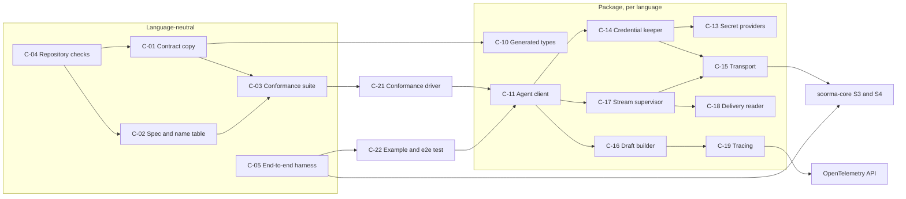
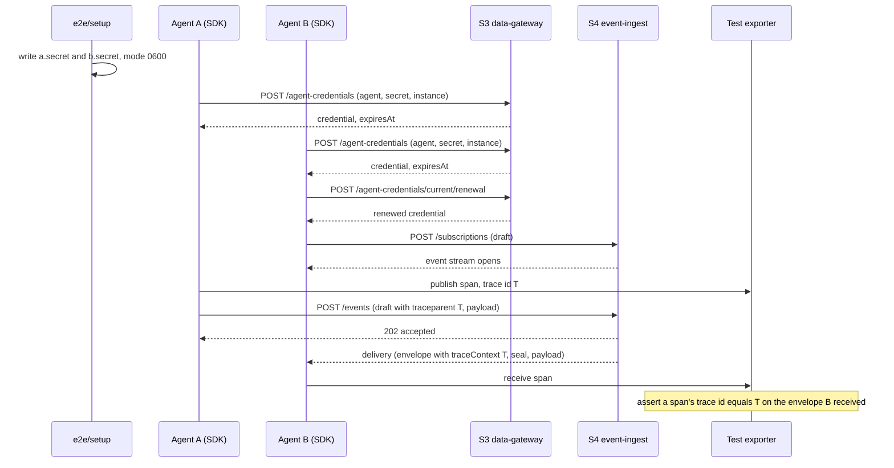

# Component Dependencies — soorma-sdk, M1

## 1. Dependency Matrix

Row depends on column. **B** build time (generated or read as data), **R** run time, **T** test
time.

| Component | C-01 | C-02 | C-03 | C-05 | C-10 | C-11 | C-12 | C-13 | C-14 | C-15 | C-16 | C-17 | C-18 | C-19 | C-20 | C-21 |
|---|---|---|---|---|---|---|---|---|---|---|---|---|---|---|---|---|
| C-03 Conformance suite | B | B | | | | | | | | | | | | | | T |
| C-04 Repository checks | B | B | | | B | | | | | | | | | | | T |
| C-06 CI workflows | | | T | T | | | | | | | | | | | | |
| C-10 Generated types | B | | | | | | | | | | | | | | | |
| C-11 Agent client | | | | | | | R | | R | R | R | R | | R | R | |
| C-14 Credential keeper | | | | | R | | R | R | | R | | | | | R | |
| C-15 Transport | | | | | R | | R | | | | | | | | R | |
| C-16 Draft builder | | | | | R | | | | | | | | | R | | |
| C-17 Stream supervisor | | | | | | | | | R | R | R | | R | R | R | |
| C-18 Delivery reader | | | | | R | | | | | | | | | | R | |
| C-18 `Delivery.publish` | | | | | | | | | R | R | R | | | R | R | |
| C-19 Tracing | | | | | | | | | | | | | | | | |
| C-21 Conformance driver | | | | | | R | R | R | | | | R | R | | R | |
| C-22 Example, e2e test | | | | T | | R | R | R | | | | R | R | | R | |

- **C-19 Tracing** depends on the OpenTelemetry **API** only (an external package, no-op until
  the tenant installs an OpenTelemetry SDK). No component depends on an OpenTelemetry SDK or
  exporter; the end-to-end test (C-22) installs one, test only
- **C-13 Secret providers** depends on nothing in the package: it reads a file and returns a
  string
- **C-05 End-to-end harness** depends on soorma-core at `contract-v0.1.0` (cloned, never
  changed) and on nothing in the packages: its set-up uses raw calls (US-11 #4)
- **No cycles.** The packages never depend on C-03, C-04, C-05 or C-06

## 2. Communication Patterns

| From | To | Pattern |
|---|---|---|
| C-15 Transport | soorma-core S3 | HTTPS request and response (TLS, verification on) |
| C-15 Transport | soorma-core S4 | HTTPS request and response (publish); HTTPS with a `text/event-stream` response (subscribe) |
| C-14 Credential keeper | C-17 Stream supervisor | in-process notification: *new credential* |
| C-17 Stream supervisor | tenant code | async iterator of items, in order |
| C-03 Runner | C-21 Driver | JSON lines over stdin and stdout, one process per run |
| C-03 Runner | Stub | in-process control; the SDK reaches the stub over TLS |
| C-05 `e2e/setup` | C-22 agent processes | one file per agent secret (`0600` in a `0700` directory), read through `fileSecret` |

## 3. Component Diagram

**Text alternative**: the contract copy (C-01) feeds the generated types (C-10) and the
conformance suite (C-03), which also reads the specification (C-02). The repository checks
(C-04) read C-01 and C-02. Inside each package, the agent client (C-11) uses the credential
keeper (C-14), the draft builder (C-16) and the stream supervisor (C-17). The keeper uses the
secret providers (C-13) and the transport (C-15); the supervisor uses the transport and the
Delivery reader (C-18); the draft builder uses tracing (C-19), which uses only the
OpenTelemetry API. The transport alone talks to soorma-core's S3 and S4. The conformance suite
drives the package through a per-language driver (C-21); the example and end-to-end test
(C-22) use the package against the stack the end-to-end harness (C-05) brings up.

## 4. Data Flow of *Done When* 2, 3 and 5

**Text alternative**: the set-up script writes each agent's secret to its own file. Each agent
reads its secret through `fileSecret` and bootstraps at S3, receiving a credential and its
`expiresAt` (*done when* 2); B renews once. B subscribes at S4 and its stream opens. A starts
a publish span with trace id T, publishes with a draft carrying `traceparent` T, and gets
`202`. S4 delivers to B the envelope, carrying T, with its seal and payload (*done when* 3).
The test-installed exporter holds a span whose trace id equals T on the envelope B received
(*done when* 5).
