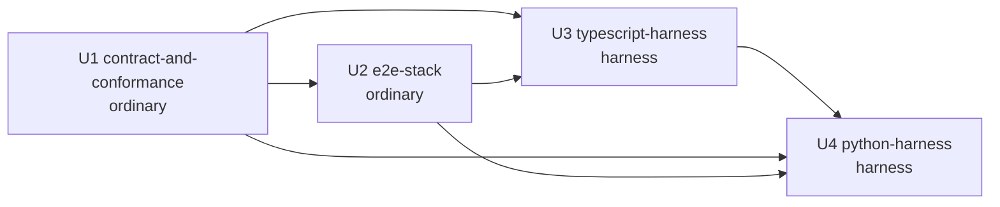

# Unit Dependencies — soorma-sdk, M1

## 1. Dependency Matrix

Row depends on column.

| Unit | U1 `contract-and-conformance` | U2 `e2e-stack` | U3 `typescript-harness` | U4 `python-harness` |
|---|---|---|---|---|
| U1 | — | | | |
| U2 | | — | | |
| U3 | **Yes**: the contract copy (types generated from it), the specification and name table, the cases, the runner and stub, the driver protocol, the checks | **Yes**: the stack, set-up and secret files for its end-to-end test and example | — | |
| U4 | **Yes**: as U3 | **Yes**: as U3 | **Soft**: none in code. Follows the order (D-01); its design may reuse U3's design decisions where the language does not change them | — |

- **U1 and U2 are independent of each other** and of the language units. U2 calls no SDK code;
  U1 calls no stack
- **No cycle.** No unit depends on a later one
- **External**: U1 and U2 depend on soorma-core at `contract-v0.1.0` (commit `c1e3d7f3…`),
  read and cloned, never changed. U3 and U4 depend on the OpenTelemetry API package (C-19)

## 2. What Each Unit Hands the Next

| From | To | Hand-over | Contract between them |
|---|---|---|---|
| U1 | U3, U4 | The vendored contract and `PIN` | Types are generated from the copy; the generated-types check fails on any difference |
| U1 | U3, U4 | The specification and the name table | Every statement is implemented; every exported name is in the table (names check) |
| U1 | U3, U4 | The cases, runner and stub; the driver protocol | Each language's driver speaks the protocol; the runner fails on any skipped or failing case |
| U1 | U3, U4 | The span rules, including US-Q1's | C-19 implements them in each language |
| U1 | U3, U4 | CDI-02's runtime checks | Each driver's `inspect` implements U1's definition |
| U2 | U3, U4 | `core-up`, `setup`, `core-down`; the end-to-end job skeleton; the secret files' layout | Each language's end-to-end test and example read secrets through `fileSecret` from the files `setup` wrote; each job uses its own fresh stack |

## 3. Build Order

**Text alternative**: U1 is built first, then U2, then U3, then U4. U3 needs both U1 (the
contract copy, specification, cases and runner) and U2 (the stack). U4 needs U1 and U2, and
comes after U3 by the order (D-01), not by a code dependency. The edge from U1 to U2 is order
only: U2 does not use U1's code.

**Why U1 and U2 are not in parallel**: one unit at a time, design and code, each with its
design PR and code PR (pr-checkpoint). U2 is small; running it second keeps a single line of
gates.

## 4. Proof Points

| Unit | Proves, in CI on its code PR |
|---|---|
| U1 | The reference driver passes every case it covers; each negative control (retains the secret; reorders the forwarded envelope's text; retries a publish; skips a stream boundary item) fails on its named case |
| U2 | `core-up`, `setup`, one raw `POST /agent-credentials` per agent answered `200`, `core-down`, printing no secret or credential; the CI time measured, run ID recorded |
| U3 | Every case through the TypeScript driver on Node 24 and 26; *done when* 2, 3, 5 end to end: **M1's proof** |
| U4 | Every case through the Python driver on 3.11 and the newest; *done when* 2, 3, 5 end to end |
